<!-- HEADER ANIMADO -->
<!-- 

  

-->
<h1 align="center">💪😎 Olá! Eu sou o Carlos</h1>
<h3 align="center">💻 Full Stack Developer | Software Engineering | Data Science / ML</h3>

---

  

 

  
  
  

  <!--  -->

  
  

